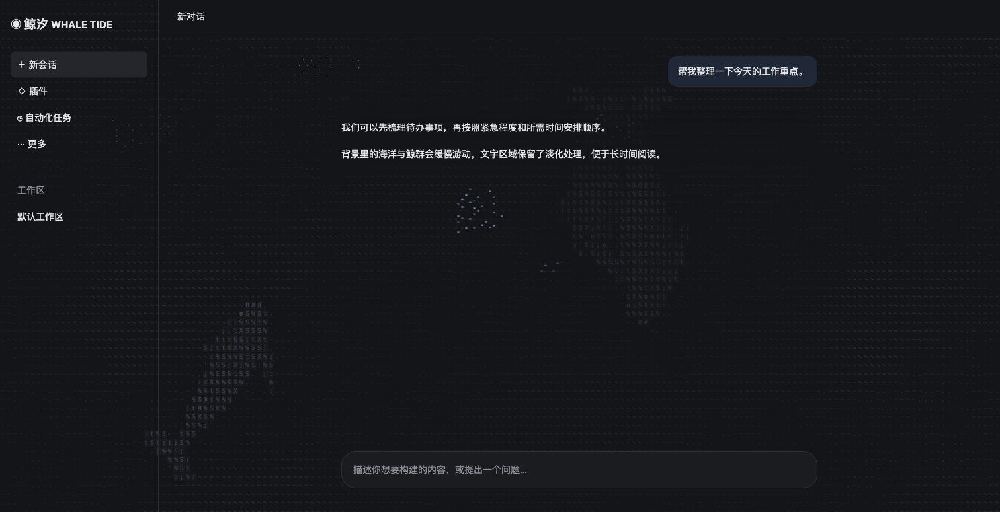
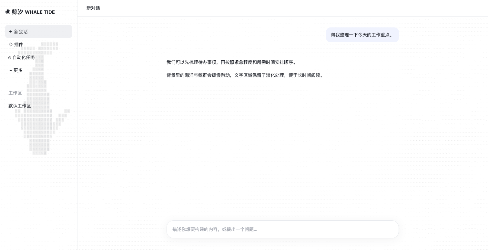
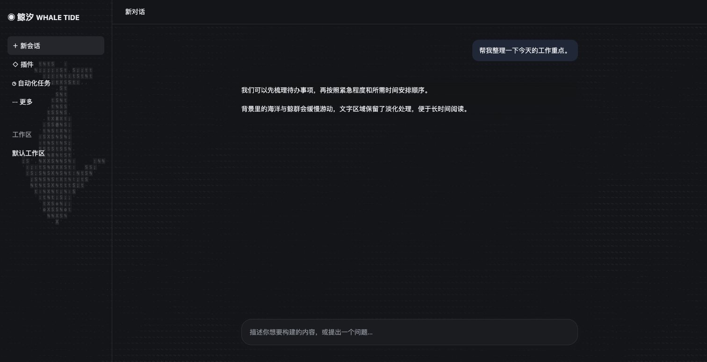
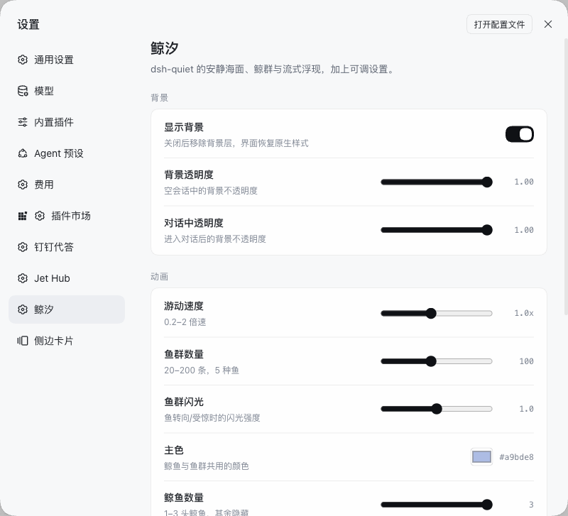

# Whale Tide

A DeepSeek Harness background plugin built on the **dsh-quiet 0.3.0 template**:
a quiet dot-matrix ocean, slowly swimming whales, a frosted sidebar, blur-to-clear
streaming replies, plus a settings panel.

> Backdrop engine, conversation model and streaming renderer come from
> [dsh-quiet](https://github.com/AvenYQ/dsh-quiet) (MIT, © 2026 AvenYQ).
> Settings are the Whale Tide addition.

## Features

- **Quiet ocean** — low-contrast ASCII sea with procedurally built whales.
- **Rich fish schools (from dsh-ascii-whales)** — five species (sardine, anchovy, silverside, mackerel, goby), about 100 fish by default, with depth, turn/alarm glints, schooling and whale predation/respawn.
- **Conversation ebb** — creatures roam the sidebar and chat while empty;
  entering a conversation sends them to the edges, leaving calm water and at
  most one resident whale behind the sidebar glass.
- **Blur-to-clear streaming** — replies reveal character by character; native
  rendering is used under reduced motion.
- **Settings** — thirteen live controls at Settings → Whale Tide, persisted in
  `localStorage`.
- **Theme aware** — follows the Harness light/dark scheme.

## Screenshots

| Empty session (light) | Empty session (dark) |
| --- | --- |
|  |  |

| Conversation (light) | Conversation (dark) |
| --- | --- |
|  |  |

| Settings (light) | Settings (dark) |
| --- | --- |
|  |  |

> Captured from `tools/preview/index.html` and the real Harness settings panel.

## Settings

| Group | Setting | Default | Range |
| --- | --- | --- | --- |
| Backdrop | Show background | on | on / off |
| Backdrop | Opacity | 1.00 | 0–1 |
| Backdrop | Opacity in conversation | 1.00 | 0–1 |
| Motion | Swimming speed | 1.0× | 0.2–2 |
| Motion | Fish count | 60 | 20–200 |
| Motion | Fish glint | 1.0 | 0–2 |
| Motion | Accent color | `#a9bde8` | any colour (whales + fish) |
| Motion | Whale count | 3 | 1–3 |
| Motion | Sidebar fish | 6 | 0–12 |
| Interface | Cell size | 9 px | 6–12 |
| Interface | Sidebar blur | 6 px | 0–20 |
| Interface | Frosted composer | on | on / off |
| Interface | Stream blur | 10 px | 0–20 |

## Install

```bash
dsh plugin --profile <profile> add github:MinEagle/dsh-whale-tide
```

## Development

```bash
npm test
node tools/preview.mjs
```

## License

MIT. See [THIRD_PARTY_NOTICES.md](THIRD_PARTY_NOTICES.md) and `LICENSE.dsh-quiet`.
