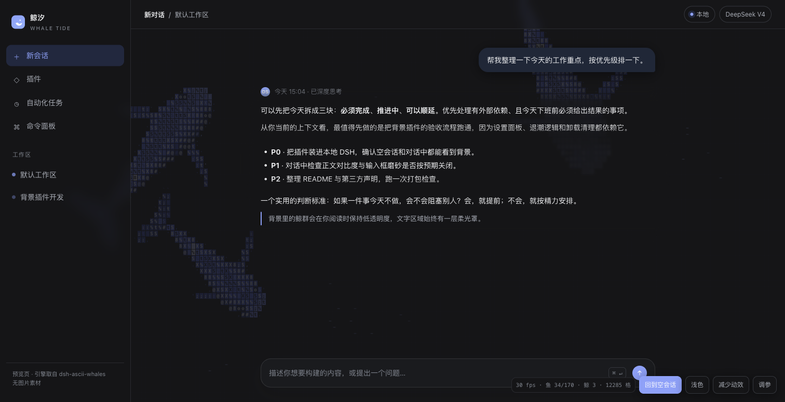
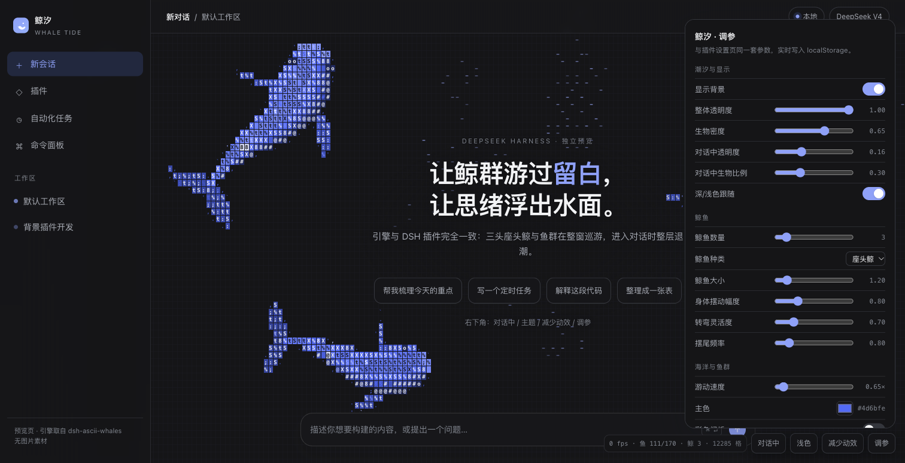

# Whale Tide

> Let the pod cross the whitespace; let the thinking surface.

A dynamic background plugin for DeepSeek Harness (DSH): three humpback whales
and fish schools roam the **whole window**, not a fixed strip at the bottom. **Everything is drawn in code;
there are no runtime image assets.** An empty conversation is high tide; an
active conversation ebbs the ocean so text stays readable; when you return to
the empty conversation the fish swim back in from the edges.

[中文](README.md) · [Design](docs/design.md) · [Pitfalls](docs/pitfalls.md) · [Third-party notices](THIRD_PARTY_NOTICES.md)


| Empty conversation · light | Empty conversation · dark |
| --- | --- |
|  |  |

| Active conversation · ebbed | Settings · light (same controls as the preview) |
| --- | --- |
|  |  |

| Active · dark | Settings · dark |
| --- | --- |
|  |  |

## Features

- **Code-only rendering** — no PNG / WebP / GIF / MP4 runtime assets. The
  whale, fish, wake, and dotted seabed are glyphs and rectangles on a canvas.
- **Whale + schools** — the actual `World` / `AsciiRenderer` swimming
  implementation from [dsh-ascii-whales](https://github.com/Chael-Chael/dsh-ascii-whales):
  three humpbacks roam the full viewport with body waves and a per-joint bend
  limit; Reynolds boids with an `Int32Array` spatial hash. Fish scatter around
  the whale and the pointer, then regroup.
- **High tide / ebb tide** — `hero`: full opacity, all fish, frosted composer.
  `active` uses dsh-quiet's full-window ebb: opacity falls to 16% and 30% of
  the fish remain.
- **Conversation readability** — 14 host surface tokens (bg layers, bubble,
  borders, labels) become lightly translucent, each assistant message gets a
  local `.dshwt-prose` halo panel (::before + 2px blur), the composer keeps a
  0.74/0.78 frosted tint with 3px blur, popovers stay opaque and borders are
  0.5px at DPR>=2.
- **Configurable** — exactly eight settings, applied live, saved in
  `localStorage`, with a restore-defaults button.
- **Light / dark** — following the DSH theme switches the backdrop colour,
  sidebar glass, text halo, composer glass and canvas palette together. The
  scheme is read from `data-ds-theme-source`, `body[data-ds-dark-theme]`,
  `color-scheme` and the theme service, never from the body background.
- **Quiet** — respects `prefers-reduced-motion` (settles and draws one frame);
  pauses `requestAnimationFrame` while the page is hidden.
- **Clean unmount** — removing the plugin deletes the layer, canvas, styles
  and every `body` attribute.
- **No build step** — hand-written JS is published as-is. No `prepare`,
  `build`, or esbuild, so pnpm 10's build-script gate cannot block a git or
  local-directory install.

## Compatibility

- DSH: `>=0.2.0-rc.2 <0.3.0-0` (installed and activated on `0.2.2-rc.1`)
- Node: `>=20`
- Browser: the Chromium engine of the DSH desktop / Web GUI

The range lives only in `engines.dsh`. The package declares **no
`@deepseek-ai/dsh-*` peerDependencies**, so the compatibility preflight cannot
reject it for an unrelated peer range.

## Install

From npm (once published):

```bash
dsh plugin --profile <your-profile> add dsh-whale-tide
```

From the 0.3.0 GitHub Release tarball:

```bash
dsh plugin --profile <your-profile> add \
  https://github.com/MinEagle/dsh-whale-tide/releases/download/v0.3.0/dsh-whale-tide-0.3.0.tgz
```

From a local checkout:

```bash
dsh plugin --profile <your-profile> add /absolute/path/to/dsh-whale-tide
```

In DSH Desktop you can also use **Settings → Plugins → Add plugin** with the
npm name or a local directory.

After installation:

1. Open **Settings → Whale Tide** and confirm the eight controls.
2. Return to an empty conversation: the full backdrop and frosted composer
   should appear.
3. Send a message: the phase becomes `active`; the ocean ebbs and the text
   stays crisp.
4. Return to an empty conversation: the fish swim back in from the edges.

> The client declares `dsh.client.immediately: true`, so it mounts at page
> load instead of waiting for the settings page to open.

## Settings (24, aligned with dsh-ascii-whales)

Four groups; changes apply live, persist in `localStorage`
(`dsh-whale-tide:v1`), and "Restore defaults" resets everything.

### Tide and display (this plugin)

| Setting | Default | Range | Notes |
| --- | --- | --- | --- |
| Show background | on | on / off | Removes the layer and `body` attributes |
| Opacity | 1.00 | 0–1 | Layer opacity in an empty conversation |
| Creature density | 0.65 | 0–1 | Share of the school shown at high tide |
| Opacity in conversation | 0.16 | 0–0.5 | Multiplier while active |
| Creature ratio in conversation | 0.30 | 0–1 | Share of fish kept while active |
| Follow light / dark | on | on / off | Off pins the mode active when switched off |

### Whales (upstream)

| Setting | Default | Range | Notes |
| --- | --- | --- | --- |
| Whale count | 3 | 1–20 | Rebuilds the world |
| Whale species | humpback | humpback / orca | Orca is slimmer with white patches |
| Whale size | 1.2× | 0.1–10 | Rebuilds the world |
| Body swing | 0.8 | 0–3 | Body-wave amplitude |
| Turn agility | 0.7 | 0.1–3 | How fast a heading is followed |
| Tail frequency | 0.8 | 0.1–5 | Tail-beat rhythm |

### Ocean and fish (upstream)

| Setting | Default | Range | Notes |
| --- | --- | --- | --- |
| Swimming speed | 0.65× | 0.1–10 | Base speed multiplier |
| Accent color | `#4d6bfe` | `#rrggbb` | Whale, fish and wake tint |
| Colorful shimmer | off | on / off | Seven-colour glints on the body |
| Eye background | follow accent | accent / black / white | Dark backing behind eyes |
| Wake intensity | 1.0 | 0–10 | Wake and ripple strength |
| Cell size | 1.0× | 0.1–10 | Rebuilds the world |
| Grid opacity | 0.05 | 0–1 | Background grid |
| Fish count | 170 | 0–1000 | Rebuilds the world |
| Character style | ASCII | ASCII / Hanzi | Hanzi uses a serif CJK face |

### Composer glass (upstream)

| Setting | Default | Range | Notes |
| --- | --- | --- | --- |
| Frosted composer | on | on / off | Both states; lighter 0.74/0.78 tint while active |
| Glass blur | 14 px | 0–64 | Backdrop blur radius |
| Glass opacity | 0.45 | 0–1 | Tint opacity |

> Count, species, size, fish count and cell size rebuild the engine; the rest
> apply live without interrupting the swim.

## Tide model

```text
Empty conversation            data-content-phase="hero"
  backdrop opacity = opacity
  fish count       = base × density
  composer         = frosted glass

Active conversation           data-content-phase="active"
  backdrop opacity = opacity × conversationOpacity   (default 0.16)
  fish count       = base × density × conversationDensity (default 0.3)
  composer         = native style
  text             = inherited soft halo for readability

Back to empty
  opacity transitions back to full; departed fish re-enter from screen edges
```

Phase detection uses the required selector:

```js
document.querySelector('[data-conversation-content] [data-conversation-region="chat"]')
  .getAttribute('data-content-phase')
```

A `MutationObserver` plus a 500 ms fallback poll covers nodes that the host
replaces or attributes written after first paint.

## Development

There is no build.

Open the standalone preview:

```bash
open tools/preview.html
# or
python3 -m http.server 8000
# http://localhost:8000/tools/preview.html
```

The preview embeds the same engine as the plugin and adds controls for
conversation phase, theme, reduced motion, and the eight settings. It runs
without DSH.

```bash
npm test
```

The tests cover the settings model, DSH manifest contract, `engines.dsh`,
absence of install-time build hooks, the patch/client registration id, and the
locale metadata. A browser smoke harness (not shipped) loads `lib/client.js`
with a minimal module-loader and `ctx` stub to verify mount, `hero → active`
transition, layer opacity, and cleanup.

## Layout

```text
dsh-whale-tide/
├── package.json
├── cordis.patch.yml
├── lib/
│   ├── index.js          # Host half; one empty apply()
│   ├── client.js         # Single browser bundle: engine + DSH wiring + settings
│   └── settings.js       # Defaults / normalize / ranges (tests and docs)
├── locale/zh.json en.json
├── icon.svg
├── tools/preview.html    # Single-file standalone preview
├── docs/design.md
├── docs/pitfalls.md
├── docs/media/           # README images (excluded from npm)
├── vendor/ascii-sharks/  # Pinned MIT source snapshot + LICENSE
├── vendor/dsh-ascii-whales/ # Engine license and provenance
├── test/
├── LICENSE
└── THIRD_PARTY_NOTICES.md
```

## Performance notes

- Fixed timestep `1/60` with at most 4 catch-up steps per frame.
- 8 px cells; about 17,520 cells at 1920×876.
- Upstream ASCII renderer: clear, restore the grid background, then draw
  whales, dots, fish, heat and wake every frame; ~30 fps in the preview at
  1920×876. `GlyphAtlas` / `InkRamp` remain on the engine's Kanji path.
- Fish are bucketed by depth/turn/alarm, one `fillStyle` per bucket.
- `InkRamp` (engine Kanji path) measures a glyph pool once at startup and
  builds a 64-level ramp; the ASCII path draws with `fillText` directly.
- The engine loads fonts (`document.fonts.load`) before setting the canvas
  font; reduced motion settles for four seconds, then draws one frame.

See [docs/design.md](docs/design.md).

## Known limitations

- The whale is a stylised glyph creature; at low DPI or in very narrow windows
  its outline gets coarser. That is the char-grid trade-off, not image scaling.
- The conversation DOM is not a public API. Only `data-content-phase` and
  `data-conversation-*` are used; if DSH changes them, the plugin degrades to
  the `hero` state instead of breaking.
- The UI exposes 24 settings from upstream; internal steering and hunger
  constants stay in the engine.
- 0.3.0 is available as a GitHub Release tarball but not yet on the npm
  registry; the repository also includes a local directory install and a
  packed `dist/*.tgz`.

## License

MIT © 2026 MinEagle. Full attributions in
[THIRD_PARTY_NOTICES.md](THIRD_PARTY_NOTICES.md):

- [ascii-sharks](https://github.com/stackedlol/ascii-sharks), © 2026 drewdi,
  MIT (fixed timestep, boids, ridge creature, rasterization, shading, wake)
- [dsh-quiet](https://github.com/AvenYQ/dsh-quiet), © 2026 AvenYQ, MIT
  (full-window backdrop, text glow, ebb-tide idea)
- [dsh-ascii-whales](https://github.com/Chael-Chael/dsh-ascii-whales), MIT
  (the full-window swimming engine: World / OceanEngine / AsciiRenderer,
  whales, fish, GlyphAtlas / InkRamp)
