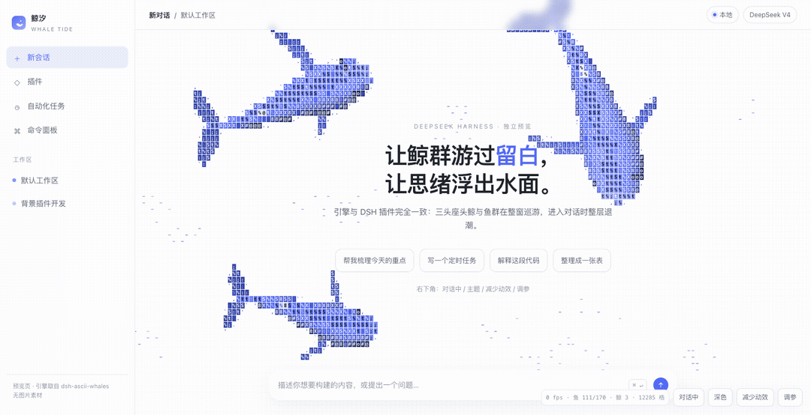
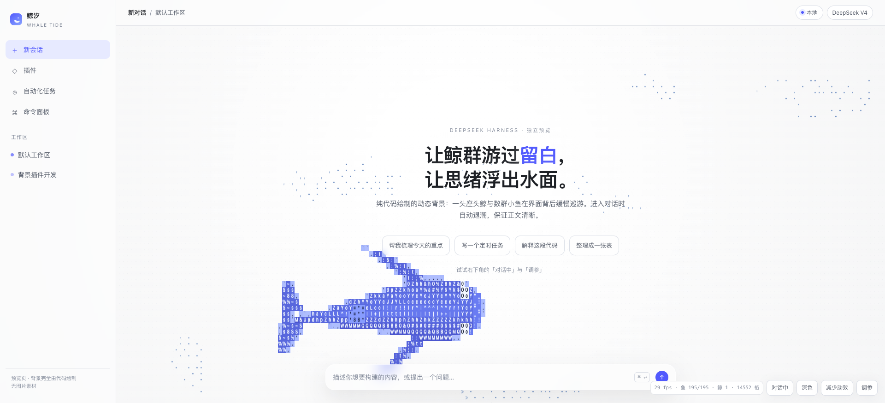
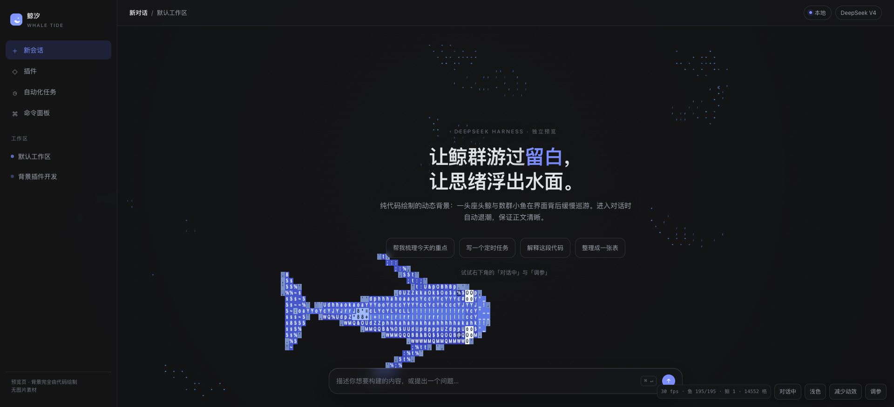
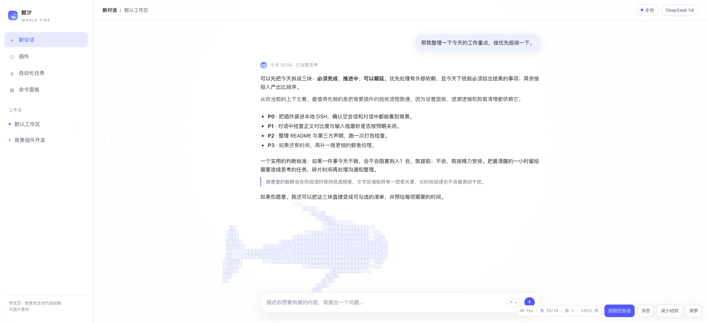
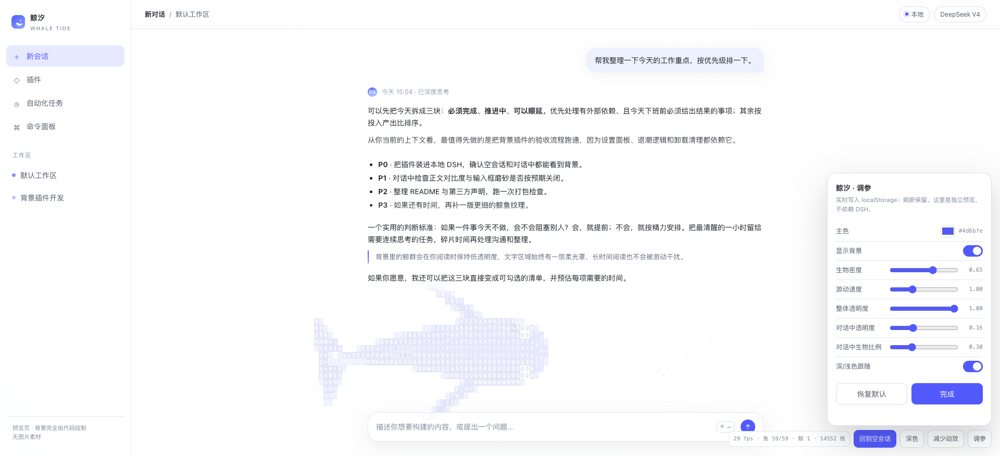

# 鲸汐 · Whale Tide

> 让鲸群游过留白，让思绪浮出水面。

DeepSeek Harness（DSH）的动态背景插件：一头座头鲸与数群小鱼在界面背后缓慢巡游。
**全部由代码绘制，零图片素材**。空会话是满潮，进入对话自动退潮，回到空会话再从边缘游回来。

[English](README.en.md) · [设计说明](docs/design.md) · [踩坑记录](docs/pitfalls.md) · [第三方声明](THIRD_PARTY_NOTICES.md)



| 空会话 · 浅色 | 空会话 · 深色 |
| --- | --- |
|  |  |

| 对话中 · 退潮（正文清晰） | 设置页（独立预览中的同款参数） |
| --- | --- |
|  |  |

## 特性

- **纯代码渲染**：没有 PNG / WebP / GIF / MP4 运行时素材；鲸鱼、鱼群、尾迹、点阵底纹全部由 Canvas 字符与色块生成。
- **鲸鱼 + 鱼群**：座头鲸脊线游动、摆尾、转弯；鱼群基于 Boids（分离 / 对齐 / 聚合 + 空间哈希桶），受鲸鱼与鼠标惊扰时会短暂散开再聚拢。
- **满潮 / 退潮**：空会话 `hero` 全不透明度、全部鱼群、输入框磨砂玻璃；对话 `active` 自动降到 16% 透明度、保留 30% 鱼群、关闭磨砂，正文优先。
- **可配置**：设置页只暴露 8 项，改完立即生效，刷新保留，带「恢复默认」。
- **安静**：尊重 `prefers-reduced-motion`（只画一帧静态画面）；页面隐藏时暂停 `requestAnimationFrame`。
- **干净卸载**：移除插件后删除背景层、Canvas、样式与所有 `body` 属性，界面恢复原状。
- **无构建**：仓库直接发布手写 JS，没有 `prepare` / `build` / `esbuild`，从 git 或本地目录安装都不会被 pnpm 10 的构建脚本策略拦截。

## 兼容性

- DSH：`>=0.2.0-rc.2 <0.3.0-0`（已在 `0.2.2-rc.1` 上安装并激活设置页）
- Node：`>=20`
- 浏览器：DSH 桌面端 / Web GUI 的 Chromium 内核

兼容范围只写在 `package.json` 的 `engines.dsh` 里，**没有声明任何 `@deepseek-ai/dsh-*` peerDependencies**，避免版本预检拒绝安装。

## 安装

从 npm 安装（插件发布后）：

```bash
dsh plugin --profile <你的 profile> add dsh-whale-tide
```

从本地目录安装：

```bash
dsh plugin --profile <你的 profile> add /absolute/path/to/dsh-whale-tide
```

也可以在 DSH Desktop 的 **设置 → 插件 → 添加插件** 里选择 npm 包名或本地目录。

安装后：

1. 打开 **设置 → 鲸汐**，确认 8 项参数出现；
2. 回到空会话，界面背后应出现满潮背景与磨砂输入框；
3. 发一条消息进入 `active` 状态，背景应自动退潮，正文保持清晰；
4. 回到空会话，鱼群会从屏幕边缘重新游入。

> 说明：插件通过 `dsh.client.immediately: true` 在页面启动时加载，不依赖“先打开设置页”才生效。

## 设置（8 项）

| 设置 | 默认 | 范围 | 说明 |
| --- | --- | --- | --- |
| 显示背景 | 开 | 开 / 关 | 关闭后移除背景层与 `body` 属性，界面恢复原生样式 |
| 生物密度 | 0.65 | 0–1 | 鱼群数量；设为 0 只保留鲸鱼 |
| 游动速度 | 1.00× | 0.1–3 | 鲸鱼与鱼群的基准速度倍率 |
| 整体透明度 | 1.00 | 0–1 | 空会话中的背景不透明度 |
| 对话中透明度 | 0.16 | 0–0.5 | 进入对话后的**乘数**；最终值 = 整体透明度 × 该值 |
| 对话中生物比例 | 0.30 | 0–1 | 进入对话后保留的鱼群比例 |
| 主色 | `#4d6bfe` | `#rrggbb` | 鲸鱼、鱼群与尾迹的主色 |
| 深/浅色跟随 | 开 | 开 / 关 | 开：跟随 DSH 主题；关：固定为关闭时的深浅色（记录在 `dsh-whale-tide:scheme`） |

偏好保存在浏览器 `localStorage`，key 为 `dsh-whale-tide:v1`；存储不可用时设置仍会在当前页面生效，并显示提示。

## 退潮模型

```text
空会话 / 无对话容器          data-content-phase="hero"
  背景透明度 = opacity
  鱼群数量   = base × density
  输入框     = 磨砂玻璃

对话中                        data-content-phase="active"
  背景透明度 = opacity × conversationOpacity   (默认 0.16)
  鱼群数量   = base × density × conversationDensity (默认 0.3)
  输入框     = 恢复原生样式
  正文       = 继承式柔光（text-shadow）保证可读

回到空会话
  透明度过渡回 1；离场鱼群从屏幕四边重新游入
```

相位检测使用需求指定的选择器：

```js
document.querySelector('[data-conversation-content] [data-conversation-region="chat"]')
  .getAttribute('data-content-phase')
```

并以 `MutationObserver` + 500 ms 轮询兜底，避免框架替换节点或延迟写入属性时漏掉切换。

## 开发

不需要构建。直接打开独立预览：

```bash
open tools/preview.html
# 或
python3 -m http.server 8000
# http://localhost:8000/tools/preview.html
```

独立预览包含与插件完全相同的引擎，并提供「对话中 / 深色 / 减少动效 / 调参」按钮，可在不启动 DSH 的情况下调参和截图。

运行仓库测试：

```bash
npm test
```

测试覆盖：

- `lib/settings.js` 的默认值、范围钳制、非法颜色/类型、恢复默认；
- `package.json` 的 DSH 客户端契约、`engines.dsh`、无安装期构建脚本；
- `cordis.patch.yml` 与 `lib/client.js` 的注册 id 是否逐字等于包名；
- `locale/*.json` 的插件元数据与设置标签完整性。

浏览器端冒烟测试可在任意静态服务器打开一个页面，注入最小 `__ModuleLoader__` 与 `ctx`，加载 `lib/client.js`，验证：背景层挂载、`hero/active` 相位切换、透明度变化、卸载后无残留 DOM/属性。

## 文件结构

```text
dsh-whale-tide/
├── package.json
├── cordis.patch.yml
├── lib/
│   ├── index.js          # 宿主侧，一行 apply
│   ├── client.js         # 单文件浏览器端（引擎 + DSH 集成 + 设置页）
│   └── settings.js       # 默认值 / normalize / 范围表（供测试与文档）
├── locale/zh.json en.json
├── icon.svg
├── tools/preview.html    # 单文件独立预览（不依赖 DSH）
├── docs/design.md        # 架构、阶段模型、性能取舍
├── docs/pitfalls.md      # 实际踩坑记录
├── docs/media/           # README 截图 / 动图（不进入 npm 包）
├── vendor/ascii-sharks/  # 上游 MIT 源码快照 + LICENSE
├── test/
├── LICENSE
└── THIRD_PARTY_NOTICES.md
```

## 性能与实现

- 固定步长引擎：`STEP = 1/60`，`MAX_STEPS = 4`，累加器追帧；掉帧时最多补 4 步，避免雪崩。
- 网格：约 9 px 字符格；1920×876 下约 14,500 格。字符图集按「字符 + 颜色」缓存，上限 6000 条，超限清空重建。
- 脏格重绘：每帧只重绘上一帧与当前帧内容并集的格子，其余格子不动；背景点阵与暗角绘制在离屏画布上，脏格用 `drawImage` 局部恢复。
- 鲸鱼：脊线头节点沿水平巡游路径行进，后续节点受 `maxBend` 约束；渲染时叠加行波，形成摆尾与身体弯曲。
- 鱼群：Boids + `Int32Array` 头链表空间哈希；按深度 / 转向 / 警报分桶，避免每帧为每条鱼设置一次 `fillStyle`。
- InkRamp：启动时把候选 ASCII 字符渲染到离屏 Canvas，读取 `getImageData` 的 alpha 累加得到墨量，排序后采样成 64 档查表（同样的实现可直接换汉字池）。
- 字体：先 `document.fonts.load(...)` 再 `document.fonts.ready`，之后才创建字形图集，避免缓存 fallback 字。
- 页面隐藏暂停 rAF；`prefers-reduced-motion` 时模拟 4 秒后只画一帧。

详见 [docs/design.md](docs/design.md)。

## 已知限制

- 鲸鱼是**风格化**的字符鲸：在低 DPI / 窄窗口下轮廓会变粗；这是字符栅格化的取舍，不是图片缩放。
- DSH 内部的会话 DOM 不是公开 API。相位检测只用 `data-content-phase` 与 `data-conversation-*` 属性；若未来 DSH 改动这些属性，插件会退化到「始终 hero」，不会报错或破坏页面。
- 设置项按需求固定为 8 项；更深的自定义（字符集、尾迹强度、鲸鱼数量）保留在引擎内部，不暴露 UI。
- 0.1.0 尚未发布到 npm registry；仓库内附可直接安装的本地目录与 `dist/*.tgz` 打包产物。

## License

MIT © 2026 MinEagle。第三方来源与完整 MIT 声明见 [THIRD_PARTY_NOTICES.md](THIRD_PARTY_NOTICES.md)：

- [ascii-sharks](https://github.com/stackedlol/ascii-sharks)，© 2026 drewdi，MIT（固定步长、Boids、脊线、栅格化、明暗、尾迹）
- [dsh-quiet](https://github.com/AvenYQ/dsh-quiet)，© 2026 AvenYQ，MIT（全窗背景层、正文柔光罩、退潮思路）
- [dsh-ascii-whales](https://github.com/Chael-Chael/dsh-ascii-whales)，MIT（DSH 设置页接线、GlyphAtlas / InkRamp 与座头鲸轮廓参考）
